  

# Falcon Lens | عدسة الصقر

**What it is.** A helper that checks a suspicious link, message, email or picture and tells you, in clear Arabic and English, what it found and what to do now.

**Who it protects.** People in the UAE who receive fake fine, delivery, bank and UAE Pass messages, and above all older and non-technical residents.

**Why it is different.** It is designed to catch brand-new fake pages that no warning list knows yet, a fixed set of rules decides the result instead of an AI, and nothing is sent outside the system until a person approves it.

**ما هو.** مساعد يفحص الرابط أو الرسالة أو البريد أو الصورة التي تشكّ فيها، ويخبرك بوضوح، بالعربية والإنجليزية، بما وجده وماذا تفعل الآن.

**من يحمي.** سكان الإمارات الذين تصلهم رسائل مزيفة عن المخالفات والتوصيل والبنوك والهوية الرقمية، وخصوصاً كبار السن وغير المتخصصين في التقنية.

**لماذا يختلف.** صُمّم ليكشف الصفحات المزيفة الجديدة التي لا تعرفها قوائم التحذير بعد، والنتيجة تحددها قواعد ثابتة لا الذكاء الاصطناعي، ولا يُرسَل أي شيء خارج النظام إلا بعد موافقة إنسان.

المشروع مستقل، وليس تابعاً لشرطة أبوظبي ولا معتمداً منها.

> [!IMPORTANT]
> **This is a hackathon prototype that is still being built.** The pictures on this page show how the product is designed to work. The section [What is built today](#what-is-built-today) says honestly which parts exist now. Falcon Lens is an independent entry for the Abu Dhabi Police x 42 "ScamShield AI" challenge. It is **not affiliated with or endorsed by Abu Dhabi Police**.

## On this page

- [What Falcon Lens offers Abu Dhabi Police](#what-falcon-lens-offers-abu-dhabi-police--ما-تقدمه-عدسة-الصقر-لشرطة-أبوظبي)
- [How it works in four steps](#how-it-works-in-four-steps)
- [The two AI helpers](#the-two-ai-helpers)
- [How the two AI agents work](#how-the-two-ai-agents-work--كيف-يعمل-الوكيلان)
- [What makes it different](#what-makes-it-different)
- [Words you may meet](#words-you-may-meet)
- [Where people use it](#where-people-use-it)
- [What is built today](#what-is-built-today)
- [Results](#results)
- [Privacy and care](#privacy-and-care)
- [What comes next](#what-comes-next)
- [For engineers](#for-engineers)
- [Licence](#licence)
- [Independence and defensive use](#independence-and-defensive-use)

## What Falcon Lens offers Abu Dhabi Police | ما تقدمه عدسة الصقر لشرطة أبوظبي

These are capabilities a police or security team could use. They are listed as an independent prototype's offer, not as a service already in use. "Built" means the code and its tests are in the main code line (pull request numbers in brackets). It does not mean a connection to any police system exists.

| Capability | What it gives the police | State |
|---|---|---|
| **Public protection حماية الجمهور** | Residents check a link, a text or WhatsApp message, an email or a QR code in Arabic, in seconds. It works as a web app that can sit on the phone's home screen with a share button, and as a Chrome extension that checks a page before it opens. | **Built** for links (#34, #35). **In progress** for messages, emails and pictures: the individual checks are merged, and joining them into one flow is open (#47). |
| **Campaign detection كشف الحملات** | The Sentinel watches every check around the clock and links similar ones into one campaign. It flags new look-alike addresses among the checks it sees, and prepares takedown and police-report drafts that wait for a human officer. | **Built** (#2, #6). It reads the checks people send. It does not yet scan the internet for new domains by itself. |
| **Brand-new fake pages الصفحات المزيفة الجديدة** | A page that claims to be a bank or a service but does not sit on that organisation's real address is flagged, even if no warning list knows it yet. No blocklist is needed. | **Built** (rule and sealed browser, #28). **Not measured yet**: no catch-rate figure exists. |
| **Operator board لوحة المشغّل** | A screen of campaigns and incidents, with approve and reject for every draft. Every action goes to an append-only audit log. | **Built** (#35). |
| **Intelligence sharing تبادل المعلومات** | Incidents can be exported in the standard STIX 2.1 format or pushed to signed webhooks. | **Built** (#30). Ready to connect, not connected. |
| **Integration الربط مع الأنظمة** | A REST API (v1) for apps and an MCP server for AI assistants, with API keys. | **Built** (#30). Ready to connect, not connected. |
| **Data sovereignty السيادة على البيانات** | The AI can run fully on local models on machines inside the UAE, with no message or page content sent out. Personal details are masked before anything goes to a cloud AI service. | **Built** (model routing, #19; local worker, #46). End-to-end wiring of the AI steps is **in progress** (#47). Accuracy in local mode is not measured yet. |
| **Observability المراقبة** | Live dashboards and alerts show how the system is running, with a runbook entry for each alert. | **Built** (#14). |
| **Measured quality جودة مقاسة** | Every figure comes from a saved test result, copied by a script. Nobody types a number by hand. | **Built**, and honest about scope: only the link-address stage is measured so far. See [Results](#results). |

Falcon Lens is independent. It uses no police logos and does not imply endorsement.

## How it works in four steps

  

1. **You paste or share it.** A link, a text message, a WhatsApp message, an email, or a picture such as a QR code. Nothing else is asked of you. Falcon Lens never asks for your name, bank details or ID.
2. **We look at the address.** Is it on a list of known scams? Is it dressed up to look like a real organisation, for example with one letter swapped? Was it registered only days ago? Clear cases can be settled here, without going any further.
3. **We open the page in a sealed browser.** The page is opened far away from your phone, in a closed-off browser that cannot reach anything else. We only look. We never type, never log in and never press a button. Then we compare what the page claims to be with who really owns the address. A page that carries a bank's name and asks for a password, but does not sit on the bank's own address, is flagged, even if it appeared an hour ago.
4. **You get a clear answer.** One of three results, in Arabic and English, each with the reasons behind it and what to do now, including what to do if you already clicked:

   | Result | In Arabic | What it means |
   |---|---|---|
   | Dangerous | خطير | We found strong signs of a scam. Do not open it. |
   | Suspicious | مشبوه | Something does not add up, or we could not finish every check. Treat it with care. |
   | No warning signs found | لم نجد علامات تحذير | We looked and found nothing wrong. Stay careful all the same. |

   Falcon Lens never calls a link "safe". Nobody can promise that, so we say only what we saw.

## The two AI helpers

  

**The Investigator | المحقّق** looks closer at one unclear case.

- It is called only when the fixed rules cannot settle a case.
- It may use a short list of approved tools, a limited number of times, to collect more facts.
- A scam page cannot give it orders. Text on a page is treated as something to examine, never as an instruction. An attempt to instruct it counts against the page.
- It cannot change the score. It adds facts and writes the explanation. Fixed code decides the result.

**The Sentinel | الحارس** watches every check, around the clock.

- It links checks that look alike, so that many fake pages copying one bank are seen as a single campaign.
- It can block a known-bad link inside our own system straight away. Every block expires and can be undone.
- It drafts takedown requests and police reports in Arabic and English.
- It sends nothing itself. A person must read the draft and approve it first. Every action is written to an append-only record (it cannot be changed by the application).

## How the two AI agents work | كيف يعمل الوكيلان

Each picture follows one agent from start to finish. The colour of each step says who acts: **fixed code** (teal), **AI** (blue) or a **human gate** (amber). The steps light up in turn. If your device is set to reduce motion, the picture stays still.

  

**The Investigator | المحقّق.** When the fixed rules cannot settle a case, the Investigator takes a closer look. The part that reads the page has no tools, so text on a scam page cannot give it orders. It may then run a small, fixed number of approved lookups. Fixed code, never the AI, sets the score, and the AI's written reasons are thrown out unless each one points to evidence.

  

**The Sentinel | الحارس.** The Sentinel listens to every finished check and groups similar ones, so many fake pages copying one bank are seen as a single campaign. Written rules decide when that is an incident. It may block a known-bad link inside our own system, and that block can be undone. Anything that would leave the system, such as a takedown request or a police report, is only a draft until an officer approves it.

## What makes it different

| | In plain words | Honest note |
|---|---|---|
| **It can catch brand-new fake pages** | Most tools wait until a fake page lands on a warning list. Falcon Lens also asks a simple question: does this page claim to be an organisation whose real address is somewhere else? | The rule is built. The sealed browser it relies on is built and merged. Its catch rate on brand-new pages is not measured yet. |
| **Code decides, not AI** | The result comes from fixed rules and a fixed formula. AI helps to read and to explain. It cannot raise or lower a score, so a scam page cannot talk its way out. | Built. |
| **A person approves anything that leaves** | The system may protect its own users on its own. A takedown request or a police report is only ever a draft until a person approves it. | The pause is built, and so is the operator's approve and reject screen. Nothing is connected to any outside organisation. |
| **It can run fully on your own machines** | In its local mode the AI runs on your own computer, and no message or page content is sent to an outside AI service. | Built. Its accuracy in this mode is not measured yet. |
| **Every number is traceable** | Any figure on this page is copied by a script from a saved test result. Nobody types a number by hand. | See [Results](#results). |

## Words you may meet

| Word | Meaning |
|---|---|
| **Phishing** | A fake message or page that pretends to be a bank, a courier or a government service in order to steal passwords, card numbers or one-time codes. |
| **Sandbox** | The sealed browser from step three. A closed room where a suspicious page can be opened and watched without being able to touch anything else. |
| **Zero-day** | A fake page so new that no warning list has heard of it yet. |
| **Campaign** | Many fake pages or messages made by the same people, usually copying the same organisation. |
| **Takedown** | A request to the company hosting a fake page to remove it. |
| **API** | A doorway that lets another program, such as a police app, ask Falcon Lens to check something and read the answer. |
| **MCP** | A newer kind of doorway made for AI assistants, so that an organisation's own assistant can ask Falcon Lens for a check. |

## Where people use it

| For | How |
|---|---|
| Residents | A web app designed in Arabic first, which can sit on the phone's home screen and, on Android, appear in the share menu. A Chrome extension that checks a page before it opens. |
| Operators, such as a police or security team | A board that shows campaigns and incidents, with approve and reject for every draft. |
| Other systems | Doorways for apps and AI assistants (an API and MCP), and a standard format for sharing threat information. These are **ready to connect, not connected**. No outside organisation is linked to Falcon Lens. |

## What is built today

The project is developed in the open, one reviewed piece at a time. This is the state of the main code line on Monday 23 November 2026.

| State | Parts |
|---|---|
| **Built and merged** | Checks on the address of a link. The fixed rules that decide the result. The service that receives a check and streams back the answer. Both AI helpers. The Chrome extension. The sealed browser. The web app, including the operator's board. The doorways for other systems (API, MCP, standard sharing format). The submission package. Monitoring dashboards. The testing tools that produce the results below. Demo tools. The attack-simulation test suite (PR #41). Joining the checks into one flow (PR #44). A local task worker (PR #46). |
| **Built in part** | Checks for text messages, emails and pictures: the individual checks are merged, and they are not yet joined into the full flow. |
| **Built, waiting for review** | Automatic improvement of the AI helper's instructions, done offline (PR #45). Wiring the AI steps and the message and email checks into the full flow (PR #47). |

Two cautions. First, "built and merged" means the code and its tests are in the main code line. It does not mean a resident can use the whole product from start to finish today. The project's own checkpoint list, [`STATUS.md`](STATUS.md), does not yet record a passed end-to-end checkpoint, so this page does not claim one. Second, the list above goes out of date quickly. The exact, piece-by-piece status is in the [technical reference](docs/TECHNICAL.md#status).

## Results

Every figure below is copied by a script from a saved test result. No number on this page is typed by hand.

**How to read it.**

- **What was tested so far.** Only the first stage: judging a link by its address, on real collected links. The line marked `scope` in the table says this in the test's own words.
- **What was not tested yet.** The sealed-browser stage, the AI helpers, messages, and brand-new fake pages. They are listed under "Not evaluated" below the table. No figure is shown for them, and none should be assumed.
- **Two sets of links.** Lines starting with `val` come from the set used to tune the rules. Lines starting with `test` come from a set that was kept aside and never used for tuning, so they are the fairer measure.
- **The values are fractions.** One means all, zero means none. The right-hand column says what each line measures and which direction is better.
- **The sets are small.** The lines ending in `ci95` give the likely range, and a wide range means the figure could move as more links are tested.

<!-- metrics:start -->
Source artifact: [`evals/results/published/20261122T182533Z.json`](evals/results/published/20261122T182533Z.json). Values are copied verbatim.

| Provenance | Value |
|---|---|
| `scope` | `offline T1 + arbiter on URLs; real data only; temporal_cut false (single poll)` |
| `created_at` | `2026-11-22T18:25:33Z` |
| `git_sha` | `ac36c6a4ece9f814cebbc337eef685c0369deb01-dirty` |
| `dataset_hash` | `382f7d6e759be20e721a3912ce4f1ca750685b9c7bd91f98116b7dcea81101b1` |
| `temporal_cut` | `false` |
| `seeds` | `{"bootstrap": 20261122, "model": 20261122, "n_bootstrap": 1000, "split": 20261122}` |
| `model_ids.llm_cloud` | `not_evaluated` |
| `model_ids.llm_sovereign` | `not_evaluated` |
| `model_ids.t1.fit_date` | `2026-11-22` |
| `model_ids.t1.git_sha` | `4415c0fa498b6b95155b09fdd43c26cff4d623d5` |
| `model_ids.t1.model_id` | `t1_hgb` |
| `model_ids.t1.model_sha256` | `41db3ba644d5084d45c3ff0fa0a11ca258caa145d7d81856a0c4fe8b9b179ed3` |
| `model_ids.t1.sklearn_version` | `1.9.1` |

| Metric | Value | In plain words |
|---|---|---|
| `test.ece` | 0.014249 | How far our stated confidence is from what really happened. Closer to zero is better. |
| `test.ece_ci95` | [0.013481, 0.048042] | Likely range for the line above if the test were repeated (lower and upper bound). |
| `test.f1` | 0.967213 | A single figure that balances recall and precision. Closer to one is better. |
| `test.f1_ci95` | [0.93202, 0.992593] | Likely range for the line above if the test were repeated (lower and upper bound). |
| `test.fpr` | 0.0375 | Of the genuine checks in the set, the share we flagged by mistake. Closer to zero is better. |
| `test.fpr_ci95` | [0.0, 0.082377] | Likely range for the line above if the test were repeated (lower and upper bound). |
| `test.n` | 140 | How many checks are in this set. |
| `test.official_false_dangerous` | 0 | Verified official sites wrongly marked dangerous. The target is zero. |
| `test.pr_auc` | 0.986588 | How well scams are ranked above genuine checks overall. Closer to one is better. |
| `test.pr_auc_ci95` | [0.96648, 0.999321] | Likely range for the line above if the test were repeated (lower and upper bound). |
| `test.precision` | 0.951613 | Of the checks we flagged, the share that really were scams. Closer to one is better. |
| `test.precision_ci95` | [0.888889, 1.0] | Likely range for the line above if the test were repeated (lower and upper bound). |
| `test.recall` | 0.983333 | Of the real scam checks in the set, the share we flagged. Closer to one is better. |
| `test.recall_ci95` | [0.948253, 1.0] | Likely range for the line above if the test were repeated (lower and upper bound). |
| `val.ece` | 0.031541 | How far our stated confidence is from what really happened. Closer to zero is better. |
| `val.ece_ci95` | [0.019403, 0.060841] | Likely range for the line above if the test were repeated (lower and upper bound). |
| `val.f1` | 0.97479 | A single figure that balances recall and precision. Closer to one is better. |
| `val.f1_ci95` | [0.938768, 1.0] | Likely range for the line above if the test were repeated (lower and upper bound). |
| `val.fpr` | 0.011905 | Of the genuine checks in the set, the share we flagged by mistake. Closer to zero is better. |
| `val.fpr_ci95` | [0.0, 0.0375] | Likely range for the line above if the test were repeated (lower and upper bound). |
| `val.n` | 144 | How many checks are in this set. |
| `val.official_false_dangerous` | 0 | Verified official sites wrongly marked dangerous. The target is zero. |
| `val.pr_auc` | 0.986559 | How well scams are ranked above genuine checks overall. Closer to one is better. |
| `val.pr_auc_ci95` | [0.966758, 1.0] | Likely range for the line above if the test were repeated (lower and upper bound). |
| `val.precision` | 0.983051 | Of the checks we flagged, the share that really were scams. Closer to one is better. |
| `val.precision_ci95` | [0.943396, 1.0] | Likely range for the line above if the test were repeated (lower and upper bound). |
| `val.recall` | 0.966667 | Of the real scam checks in the set, the share we flagged. Closer to one is better. |
| `val.recall_ci95` | [0.912251, 1.0] | Likely range for the line above if the test were repeated (lower and upper bound). |

Not evaluated in this artifact, so no figure is shown for them: `arabic_clarity`, `cost_per_check_llm`, `faithfulness`, `flip_rate_3_runs`, `injection_attack_success_rate`, `llm_tier_T3`, `sandbox_tier_T2`, `zero_day`, `synthetic`, `cloud_route`, `sovereign_route`.
<!-- metrics:end -->

## Privacy and care

- **It asks for nothing personal.** No name, no bank details, no ID.
- **It keeps very little.** It stores a fingerprint of what was checked and the result. The text of a message or email is not kept unless you choose to report it.
- **It hides personal details.** Phone numbers, Emirates ID numbers, card numbers and email addresses are masked before anything is logged or sent to an outside AI service.
- **It can stay local.** In local mode no message or page content leaves the machine. Look-ups about a web address still go out, and they carry the address only. They can be switched off.
- **It is built to be attacked.** The checker opens pages made by criminals, so the sealed browser has no way into the rest of the system, and web addresses are always shown in a form that cannot be clicked by accident.
- **It only defends.** It never imitates a real organisation, never fills in a form on a suspicious page, and never contacts real people.

The full detail is in [`docs/PRIVACY.md`](docs/PRIVACY.md) and [`docs/THREAT_MODEL.md`](docs/THREAT_MODEL.md).

## What comes next

- **Finish the full flow** for messages, emails and pictures, and join every check into one flow.
- **Measure what is not measured yet**: brand-new fake pages, the AI helpers, the local mode, and resistance to manipulation.
- **A licence for the scam list.** The prototype uses the OpenPhish community list, which allows research use only. A real deployment needs an OpenPhish licence.
- **More warning lists**, once access keys are available.
- **A real connection to a police or security system** would need an agreement with that organisation. Today the doorways exist and nothing is connected.

The engineering roadmap is in the [technical reference](docs/TECHNICAL.md#roadmap).

## For engineers

All technical detail lives in one place: **[`docs/TECHNICAL.md`](docs/TECHNICAL.md)**. Nothing was removed from the earlier README; it was moved there.

| You want | Go to |
|---|---|
| Services, networks and the request path | [System architecture](docs/TECHNICAL.md#system-architecture), with the [detailed architecture diagram](docs/assets/architecture.svg) |
| The Investigator's guardrails | [The Investigator](docs/TECHNICAL.md#the-investigator-the-agent-inside-one-check), with the [detailed diagram](docs/assets/investigator.svg) |
| The Sentinel pipeline | [The Sentinel](docs/TECHNICAL.md#the-sentinel-the-always-on-backend-agent), with the [detailed diagram](docs/assets/sentinel.svg) |
| Scoring, hard rules and bands | [How scoring works](docs/TECHNICAL.md#how-scoring-works) and [`docs/SCORING.md`](docs/SCORING.md) |
| Threat model and data handling | [Security and privacy](docs/TECHNICAL.md#security-and-privacy) |
| Commands, addresses and ports | [Run it](docs/TECHNICAL.md#run-it) |
| What each script does | [`docs/SCRIPTS.md`](docs/SCRIPTS.md) (added by PR #40, not yet merged) |
| Repository layout and contracts | [Project layout](docs/TECHNICAL.md#project-layout) and [`contracts/`](contracts) |
| Feature-by-feature status with pull request numbers | [Features](docs/TECHNICAL.md#features) and [Status](docs/TECHNICAL.md#status) |
| Evaluation method | [`docs/EVALS.md`](docs/EVALS.md) |
| Connecting another system | [`docs/INTEGRATION.md`](docs/INTEGRATION.md) |

## Licence

Placeholder: the licence will be chosen by the project owner before submission. Until a `LICENSE` file is added, all rights are reserved.

## Independence and defensive use

Falcon Lens is an independent hackathon project. It is **not affiliated with or endorsed by Abu Dhabi Police**, it uses no police branding, and it has no connection to any police system. Where this page says "ready to connect", it means a doorway exists for a future connection and nothing more.

The project is defensive only. It never registers lookalike addresses, never hosts a page that imitates a real organisation, never submits forms on suspicious pages and never messages real people. Its test pages use only the invented brand "Falcon Demo Bank" and carry a visible test label.
