<p align="center">
  
</p>

# Falcon Lens | عدسة الصقر

**An Arabic-first AI agent that checks a suspicious link, message, email or image and answers with evidence: what it found, why, and what to do now.**

<div dir="rtl" align="right">

**«عدسة الصقر» وكيل ذكاء اصطناعي صُمّم بالعربية أولاً. الصق الرابط أو الرسالة التي تشكّ فيها، فيخبرك بما وجده، ولماذا، وماذا تفعل الآن، مع الأدلة.**

أدنى حكم لدينا هو «لم نجد علامات تحذير»، ويأتي دائماً مع تذكير بالحذر. المشروع مستقل، وليس تابعاً لشرطة أبوظبي ولا معتمداً منها.

</div>

> [!IMPORTANT]
> **Build status: Phase 0 to 1, building in parallel** (from [`STATUS.md`](STATUS.md)). `main` holds the platform skeleton, the contracts, the SSRF guard, the URL signals, the arbiter, the check API and the Sentinel core rules. The cascade that joins them is in review, so no check runs end to end yet. The diagrams below show the target design. The [status table](#status) says what is merged, what is in progress and what is planned. No detection metric is published yet.

Falcon Lens is an entry for the Abu Dhabi Police x 42 "ScamShield AI" challenge. It is an independent project and is **not affiliated with or endorsed by Abu Dhabi Police**. Integration with police systems is designed as *ready to connect*; nothing is connected.

## Contents

- [Why](#why)
- [System architecture](#system-architecture)
- [The Investigator: the agent inside one check](#the-investigator-the-agent-inside-one-check)
- [The Sentinel: the always-on backend agent](#the-sentinel-the-always-on-backend-agent)
- [Features](#features)
- [How scoring works](#how-scoring-works)
- [Security and privacy](#security-and-privacy)
- [Run it](#run-it)
- [Project layout](#project-layout)
- [Evaluation](#evaluation)
- [Status](#status)
- [Roadmap](#roadmap)
- [Documentation](#documentation)
- [Licence](#licence)
- [Independence and defensive use](#independence-and-defensive-use)

## Why

People in the UAE receive fake fine, delivery-fee, bank-OTP and UAE Pass links by SMS, WhatsApp and email. The pages look official and are short-lived, so a blocklist often learns about them after people have already opened them. A warning written in English and in security jargon does little for the people who are hit hardest: older and non-technical residents.

Falcon Lens is built on four principles ([`docs/VISION.md`](docs/VISION.md)):

| Principle | What it means here |
|---|---|
| Proactive | A page that claims a brand, asks for credentials and sits on a domain the brand does not own is flagged by rule, even when no blocklist knows it. Single checks are linked into campaigns. |
| Applicable | One command starts the whole stack on a laptop. A sovereign mode keeps every model call on the local machine. |
| Truthful | Every number shown anywhere comes from a generated eval artifact. Replayed and synthetic data are labelled as such. |
| Defensive only | Suspicious pages are loaded once, passively, in an isolated sandbox. No form is ever submitted. |

This section carries no statistics on purpose: a figure appears in this repository only with a public source link or an eval artifact behind it.

## System architecture

<p align="center">
  
</p>

One check, end to end ([`docs/ARCHITECTURE.md`](docs/ARCHITECTURE.md)):

1. **In.** `POST /v1/check/url` reaches the API through the Caddy gateway. The API validates, rate-limits, assigns a `verdict_id`, puts a job on the `fl:jobs` stream and returns the SSE address. Two checks of the same URL share one job.
2. **Cascade.** The worker runs the tiers in order and can exit after any of them. After each tier it re-emits a partial verdict under the same `verdict_id`.

   | Tier | Budget | What runs |
   |---|---|---|
   | T0 | 50 ms | Canonicalise, verdict cache, verified-official registry, local feed mirror |
   | T1 | 1 s | Deterministic URL, domain and reputation signals in parallel, plus a calibrated classifier |
   | T2 | 6 s | Sandbox render, page and visual features, the brand check, the quarantined extractor |
   | T3 | 15 s | The bounded investigator, only for the uncertain band |

   The budgets are design limits from [ADR-001](docs/adr/ADR-001-cascade-arbiter.md), not measurements.
3. **Verdict.** The deterministic arbiter sets the score and the verdict. The result is stored in Postgres and streamed back over SSE.
4. **Events.** A `verdict.created` event goes to `fl:events`. The Sentinel consumes it.

Around that path:

- **Sandbox.** A Playwright service whose only network peer is the egress proxy. It returns features, never raw page content.
- **Model router.** Each role (extractor, investigator, responder, vision, sentinel) maps to a cloud model and a local model. In sovereign mode, or with no API key, every call goes to the local Ollama model.
- **Data.** Postgres with pgvector for verdicts, evidence, incidents and the append-only audit log. Redis for caches, locks, rate limits and streams.
- **Observability.** OpenTelemetry into Prometheus, Loki and an LLM tracer, with Grafana dashboards and Alertmanager. Every log line and span carries the `verdict_id`.

## The Investigator: the agent inside one check

<p align="center">
  
</p>

Models read and explain. Code decides. These guardrails hold that line ([ADR-001](docs/adr/ADR-001-cascade-arbiter.md), [`docs/THREAT_MODEL.md`](docs/THREAT_MODEL.md)):

| Guardrail | How it works |
|---|---|
| Dual-model separation | Untrusted text reaches only the quarantined extractor. That model has no tools, and its output is a strict schema of enums and short strings. The investigator and the responder see structured evidence only. |
| Spotlighting | Untrusted text is redacted, wrapped in random-nonce delimiters and datamarked line by line before any model sees it. Instruction-like text is never followed. It is recorded as risk evidence. |
| Bounded, typed tools | The investigator is an explicit state machine: plan, act, observe, decide. It emits one JSON action per step, validated against [`contracts/tools.schema.json`](contracts/tools.schema.json), with at most six tool calls per run. A provenance rule rejects any URL or domain argument that is not the input, a hop in its redirect chain, or a domain derived from those. |
| The arbiter is code | Only the arbiter sets `risk_score` and `verdict`. A model can add evidence and write the explanation. It cannot set or lower a score. |
| Grounded reasons | The responder picks at most three reasons, and each must cite existing evidence ids. A verifier rejects anything else and falls back to a native Arabic template. |

The example in the diagram uses the invented brand "Falcon Demo Bank" and defanged, reserved `.example` hosts. No real brand or live URL appears anywhere in this repository.

## The Sentinel: the always-on backend agent

<p align="center">
  
</p>

The Sentinel links single checks into incidents and campaigns ([ADR-002](docs/adr/ADR-002-sentinel-langgraph.md)):

| Stage | What happens |
|---|---|
| Listen | Redis Streams `fl:events`, consumer group `sentinel`, at-least-once delivery. Handlers are idempotent on `event_id`. Repeated failures go to a dead-letter stream. |
| Correlate | Plain, deterministic Python groups events by page fingerprint, brand, domain pattern, ASN, registrar, certificate issuer, script cluster and time window. |
| Trigger | Unit-tested rules open incidents: R1 campaign, R2 kit reuse, R3 report burst, R4 reputation flip, R5 quality. |
| Triage | A LangGraph `StateGraph` (`enrich → compare → assess → summarise → propose → act`) with a Postgres checkpointer, per-node retries and a fixed step, token and time budget per incident. |
| Act | Internal actions (block an indicator with a TTL, raise an alert, update the campaign board, export STIX) run automatically and are reversible. External actions (a takedown draft, a police report draft) stop at an `interrupt()` and wait for an operator. The Sentinel never sends them. |

Rules and correlation decide what an incident is, so incident counts are reproducible with the model stubbed. The agent only enriches an incident: severity reason, summary and proposed actions. It cannot edit rules, thresholds or scoring. Every action is written to the append-only `audit_log` with the evidence ids behind it.

## Features

Legend: **merged** is on `main` with its tests. **scaffold** means the service, schema or config is on `main` but has no product behaviour yet. **in progress** is being built on a feature branch or sits in an open pull request, and is not merged. **planned** has not started. No feature has passed a product gate (G1 and later) yet, so nothing here is usable end to end.

### Product

| Feature | Description | Status |
|---|---|---|
| URL check | Paste a link and get a progressive verdict over SSE | in progress (URL signals #1, arbiter #13 and check API #4 merged; cascade and worker in PR #18) |
| SMS and WhatsApp text check | Arabic, Arabizi and English message analysis, rule features and nearest known scam script. Every link found is checked as a URL. | in progress (signals in PR #8) |
| Email check | `.eml` parsing with no remote fetch: authentication results, header mismatches, link text against target, QR codes, attachment type and hash only | in progress (signals in PR #8) |
| Image and QR check | QR decode and quarantined OCR. Extracted links and text go through the URL and message pipelines. | in progress (signals in PR #8) |
| Arabic-first verdicts | Three verdicts: `dangerous`, `suspicious`, `no_warning_signs`. The product never says "safe". Reasons cite evidence ids. | in progress (arbiter and template reasons merged in #13; responder in PR #19) |
| Actions and reporting | What to do now, what to do if you already clicked, and reporting channels taken only from the official site ([`config/`](config)) | planned |
| PWA and share target | Next.js web app, Arabic-first RTL. Android share sheet through the PWA share target. | in progress (branch `feat/web-app`, no PR yet; scaffold merged) |
| Chrome extension | Manifest V3. Sends only the URL. Host permission only for the API origin. | in progress (no PR yet) |
| Campaign board | Similarity view of linked checks and live campaigns | planned |
| Operator incident board | Incidents, evidence, and approve or reject for drafted external actions | planned |
| REST v1 | `POST /v1/check/*`, SSE stream, `?wait=` synchronous mode, scoped API keys | in progress (check endpoints, SSE and `?wait` merged in #4; the rest of v1 has no PR yet) |
| MCP server | Streamable HTTP with bearer auth: `check_url`, `check_message`, `check_email`, `get_verdict`, `list_campaigns`, `list_incidents`, `get_incident`, `submit_report` | in progress (no PR yet; service scaffold merged) |
| STIX 2.1 export and webhooks | Incident export and HMAC-signed webhooks for police or SOC systems, ready to connect | planned |
| Sovereign mode | `FL_SOVEREIGN_MODE=true` sends every model call to the local Ollama model | in progress (model router in PR #19) |
| Observability dashboards | Six Grafana dashboards, `fl_` metrics, alerts with a runbook entry each | in progress (PR #14; stack scaffold merged) |
| Red-team suite | Prompt-injection, SSRF and XSS fixtures run by `make redteam` | in progress (no PR yet) |

### AI agents and detection core

| Feature | Description | Status |
|---|---|---|
| URL lookalike signals | Homograph, typosquat, combosquat and related lexical signals over a brand registry with verified domains | merged (#1; review fixes in PR #9) |
| Domain, certificate and feed signals | Domain age, certificate age, reputation feed mirror | in progress (branch `feat/signals-domain`, no PR yet) |
| SSRF guard | Own DNS resolution, blocked ranges, pinned IP, redirects re-checked, as a shared library | merged (#3; review fixes and egress proxy wiring in PR #16) |
| Tiered cascade and worker | T0 to T2 orchestration, early exits, partial verdicts | in progress (PR #18) |
| Deterministic arbiter | Hard rules H1 to H6, calibrated score, bands, degradation | merged (#13; scoring docs update in PR #15) |
| Sandbox capture and fixtures | Isolated Playwright capture, page features, Falcon Demo Bank fixtures | in progress (no PR yet) |
| Quarantined extractor | No tools, strict schema, spotlighted input | in progress (PR #19) |
| Bounded investigator (T3) | State machine with typed tools, the provenance rule and budgets | in progress (PR #19) |
| Responder and verifier | Reasons that cite evidence ids, with a template fallback | in progress (PR #19) |
| Model router | Cloud and local routes, redaction, fallback to local on a cloud error | in progress (PR #19) |
| Sentinel core | Correlation and rules R1 to R5 | merged (#2) |
| Sentinel triage graph | LangGraph nodes, Redis consumer, Postgres checkpointer, human-approval interrupt | in progress (PR #6) |
| Eval harness | Replayed snapshots, confidence intervals, merge gate, published artifacts | in progress (no PR yet; legit and synthetic sets in PR #7) |
| Offline prompt optimisation | DSPy on the validation split; compiled prompts are frozen | in progress (no PR yet) |

## How scoring works

The arbiter is the only component that sets `risk_score`, `calibrated_probability` and `verdict`. Full detail is in [`docs/SCORING.md`](docs/SCORING.md).

1. **Hard rules first.** A rule that fires sets the floor of the verdict, or the cap for the trust rule.
2. **Classifier probability.** A gradient-boosted model over the T1 features, calibrated on the validation split.
3. **Evidence adjustment.** Evidence from the later tiers has fixed weights in log-odds points: `logit(p) = logit(p_clf) + Σ wᵢ · confidenceᵢ`.
4. **Bands.** `dangerous`, `suspicious` or `no_warning_signs`. The thresholds are fitted on the validation split only and frozen, and evals gate any change.

| Hard rule | Condition | Effect |
|---|---|---|
| **H1** brand mismatch (zero-day) | The page claims a brand, has a credential form or payment request, and its registrable domain is not in that brand's verified list | `dangerous` |
| **H2** known bad | Fresh feed hit on the exact URL or host | `dangerous` |
| **H3** verified official | The registrable domain is in a brand's verified list, with no open-redirect abuse and no feed hit | Capped at `no_warning_signs`, never `dangerous` |
| **H4** exfiltration to a bot | A form or script posts credentials to a messaging-bot API or webhook relay | `dangerous` |
| **H5** message with a dangerous link | A message or email contains a URL whose verdict is `dangerous` | At least `dangerous` |
| **H6** OTP or remote-access ask | A message asks for an OTP or a remote-access app install and impersonates an authority or bank | At least `suspicious` |

Two rules protect the lowest verdict. A degraded check (a signal failed or timed out) is never shown as `no_warning_signs`. And the lowest verdict reads "No warning signs found" / «لم نجد علامات تحذير» with a caution reminder, never "safe".

## Security and privacy

The checker fetches content that attackers control, so it is designed as a target. The full STRIDE table is in [`docs/THREAT_MODEL.md`](docs/THREAT_MODEL.md), and data handling is in [`docs/PRIVACY.md`](docs/PRIVACY.md).

| Risk | Mitigation |
|---|---|
| A page talks the model into lowering its score | The arbiter is code. Model output cannot reach the score. Injection attempts are recorded as risk evidence. |
| SSRF into the host or internal network | Own DNS resolution, blocked private, loopback, link-local and metadata ranges, pinned IP, every redirect re-checked, and the egress proxy as a second layer |
| A browser exploit in the sandbox | Non-root, read-only root filesystem, all capabilities dropped, isolated network, fresh context per visit |
| The checker used as a free fetcher | Raw content is never returned. Screenshots only for authenticated keys. Per-IP and per-key limits. |
| Stored XSS on the boards | Text nodes only, strict CSP, URLs shown defanged and never as live links |
| Personal data leaving the machine | Phone numbers, Emirates ID, card numbers, emails and IBANs are redacted before logging and before any cloud call. Message bodies are not stored unless the user opts in to a report. |

In sovereign mode no content leaves the machine. Lookups (RDAP, certificate transparency, feeds) carry domain names only and can be switched off. The product never asks for personal, banking or ID details.

Residual risks are stated in the threat model, including that Docker Desktop on macOS provides VM isolation without gVisor, and that phishing pages may cloak against data-centre addresses.

## Run it

Requirements: Docker with Compose, and [`uv`](https://docs.astral.sh/uv/) for the test suite. Ollama on the host is optional and enables the local model route.

```bash
cp .env.example .env    # every key is optional; a missing key switches that feature off
make up                 # build and start the core and observability stacks, wait until healthy
make smoke              # one URL in, one verdict out
make demo               # the demo scenarios
```

Honest state of those targets on `main`: `make up`, `make down`, `make test` and `make scan` are implemented. `make smoke` is implemented, but it cannot pass against the real pipeline until the cascade and worker merge (PR #18); its fake-worker mode is a test double and does not count as gate G1. `make demo`, `make eval`, `make redteam`, `make seed`, `make replay` and `make submission` exit with "not yet implemented" until their gate is passed. They never pass silently.

When the stack is up:

| Service | Address |
|---|---|
| App | `https://localhost:8443` (local CA, accept the certificate warning) |
| Grafana | `http://localhost:3001` |
| Prometheus | `http://localhost:9090` |

To keep every model call local, set `FL_SOVEREIGN_MODE=true` in `.env`. The local model tags are set in `.env` and explained in [ADR-003](docs/adr/ADR-003-local-model.md).

## Project layout

```
services/api        FastAPI REST v1, SSE, auth, rate limits
services/worker     cascade orchestration (T0 to T3), signals, arbiter
services/sandbox    Playwright browser service (isolated network)
services/egress     filtering egress proxy
services/sentinel   event consumer, correlation, rules, LangGraph agent
services/mcp        MCP server (streamable HTTP)
packages/falcon_core  shared library: contracts, signals, scoring, model router, tools
web/                Next.js PWA (Arabic-first RTL), incident board
contracts/          JSON Schemas: verdict, evidence, event, incident, signal, tools
evals/              harness, dataset manifests, published results
infra/              gateway, grafana, prometheus, loki, alloy, alertmanager, otel, postgres
docs/               vision, architecture, ADRs, scoring, threat model, privacy, runbook
scripts/            repo tooling (health wait, README metrics)
```

Live phishing URLs, page snapshots and brand logos are never committed. They stay in the git-ignored `data/private/`. Only defanged URLs, hashes, embeddings and aggregates are public.

## Evaluation

The method is in [`docs/EVALS.md`](docs/EVALS.md): a temporal split grouped by registrable domain, a frozen test split, bootstrap confidence intervals, and cloud and sovereign routes reported separately. Targets are listed there. This section shows results only.

The block below is written by [`scripts/readme_metrics.py`](scripts/readme_metrics.py), which copies values verbatim from the newest file in `evals/results/published/`. Nothing in it is typed by hand.

<!-- metrics:start -->
Source artifact: [`evals/results/published/20261122T175915Z.json`](evals/results/published/20261122T175915Z.json). Values are copied verbatim.

| Provenance | Value |
|---|---|
| `created_at` | `2026-11-22T17:59:15Z` |
| `git_sha` | `c1ef83f9e16d0091856333f7ac72a35f39bae7a7` |
| `dataset_hash` | `382f7d6e759be20e721a3912ce4f1ca750685b9c7bd91f98116b7dcea81101b1` |
| `seeds` | `{"bootstrap": 20261122, "model": 20261122, "n_bootstrap": 1000, "split": 20261122}` |
| `model_ids.llm_cloud` | `not_evaluated` |
| `model_ids.llm_sovereign` | `not_evaluated` |
| `model_ids.t1.fit_date` | `2026-11-22` |
| `model_ids.t1.git_sha` | `45bbd72feae1315005cc78945a068730793b4e99` |
| `model_ids.t1.model_id` | `t1_hgb` |
| `model_ids.t1.model_sha256` | `41db3ba644d5084d45c3ff0fa0a11ca258caa145d7d81856a0c4fe8b9b179ed3` |
| `model_ids.t1.sklearn_version` | `1.9.1` |

| Metric | Value |
|---|---|
| `test.ece` | 0.014249 |
| `test.ece_ci95` | [0.013481, 0.048042] |
| `test.f1` | 0.967213 |
| `test.f1_ci95` | [0.93202, 0.992593] |
| `test.fpr` | 0.0375 |
| `test.fpr_ci95` | [0.0, 0.082377] |
| `test.n` | 140 |
| `test.official_false_dangerous` | 0 |
| `test.pr_auc` | 0.986588 |
| `test.pr_auc_ci95` | [0.96648, 0.999321] |
| `test.precision` | 0.951613 |
| `test.precision_ci95` | [0.888889, 1.0] |
| `test.recall` | 0.983333 |
| `test.recall_ci95` | [0.948253, 1.0] |
| `val.ece` | 0.031541 |
| `val.ece_ci95` | [0.019403, 0.060841] |
| `val.f1` | 0.97479 |
| `val.f1_ci95` | [0.938768, 1.0] |
| `val.fpr` | 0.011905 |
| `val.fpr_ci95` | [0.0, 0.0375] |
| `val.n` | 144 |
| `val.official_false_dangerous` | 0 |
| `val.pr_auc` | 0.986559 |
| `val.pr_auc_ci95` | [0.966758, 1.0] |
| `val.precision` | 0.983051 |
| `val.precision_ci95` | [0.943396, 1.0] |
| `val.recall` | 0.966667 |
| `val.recall_ci95` | [0.912251, 1.0] |
<!-- metrics:end -->

## Status

Gates, from [`STATUS.md`](STATUS.md):

| Gate | State |
|---|---|
| G0 `make up` healthy | in progress |
| G1 `make smoke`, URL to verdict | not started |
| G2 `make eval` baseline | not started |
| G3 red-team, scans, dashboards | not started |
| G4 MVP | not started |
| G5 Sentinel incident from replay | not started |
| G6 `make demo` and `make submission` | not started |

Work by state, from `gh pr list --state all` on Sun 22 Nov 2026 (numbers are pull requests in this repository):

| State | Work | PR |
|---|---|---|
| merged | Platform skeleton, Docker Compose stack, Makefile, CI, and the G0 review fixes | #5, #10 |
| merged | Contracts (JSON Schema and pydantic models) and the design docs | #5 |
| merged | SSRF guard and guarded HTTP client (library) | #3 |
| merged | URL lookalike signals and the brand registry | #1 |
| merged | Sentinel core: correlation and rules | #2 |
| merged | Arbiter, hard rules H1 to H6, template reasons | #13 |
| merged | Check API: endpoints, SSE, `?wait`, `make smoke` | #4 |
| merged | OpenPhish collection, hash-only (no live URL is committed) | on `main` |
| merged | Union merge for the shared log files | #12 |
| merged | README and animated diagrams | #17 |
| in progress, open PR | Sentinel LangGraph triage agent | #6 |
| in progress, open PR | Evals: legit URL set and synthetic messages | #7 |
| in progress, open PR | Message, email and image signals | #8 |
| in progress, open PR | URL signal review fixes | #9 |
| in progress, open PR | CI hotfix | #11 |
| in progress, open PR | Metrics, dashboards and alert rules | #14 |
| in progress, open PR | Scoring docs: investigator evidence names | #15 |
| in progress, open PR | SSRF review fixes and egress proxy wiring | #16 |
| in progress, open PR | Cascade T0 to T2 and worker | #18 |
| in progress, open PR | Model router, tool registry, extractor, investigator, responder | #19 |
| in progress, open PR | Environment file fix | #20 |
| in progress, open PR | Demo tooling: seed, replay, demo, tunnel | #21 |
| in progress, open PR | Brands: verification of weakly verified official domains | #22 |
| in progress, open PR | Arabic native-speaker review of brand names and verdict strings | #23 |
| in progress, open PR | Evals: fictional `.eml` fixtures for the email pipeline | #24 |
| in progress, open PR | Evals: more legitimate hard negatives | #25 |
| in progress, no PR yet | Domain, certificate and feed signals (`feat/signals-domain`) | |
| in progress, no PR yet | Sandbox capture and fixtures | |
| in progress, no PR yet | Web app (`feat/web-app`) | |
| in progress, no PR yet | Eval harness; DSPy prompt optimisation | |
| in progress, no PR yet | MCP tools and the rest of REST v1 | |
| in progress, no PR yet | Red-team suite; Chrome extension | |
| in progress, no PR yet | Submission kit | |
| planned | Actions and reporting copy, campaign board, operator incident board, STIX export, webhooks | |

Merged means the code and its tests are on `main`. It does not mean the feature is reachable by a user: gate G1 (one URL in, one verdict out) has not passed.

Reputation feeds: Google Safe Browsing is disabled (no key) and URLhaus is disabled (no key), per `STATUS.md`. The OpenPhish community feed is limited to non-commercial research use, per the terms note in [`DECISIONS.md`](DECISIONS.md).

## Roadmap

- **OpenPhish licence for production.** The community feed allows personal and research use, with no commercial use and no redistribution. This prototype mirrors it privately and publishes only defanged aggregates. A production deployment needs an OpenPhish licence.
- **More feeds.** Enable Google Safe Browsing and URLhaus when keys are available. Until then the blocklist baseline covers only the enabled feed.
- **Sandbox hardening.** gVisor or an equivalent runtime on a Linux host, and residential or mobile egress to reduce cloaking.
- **Stricter CSP.** Move the gateway from inline hydration scripts to nonces.
- **iPhone share flow.** iOS has no PWA share target, so an iOS Shortcut is planned.
- **Alert channels.** Telegram and webhook delivery for Alertmanager once a channel is configured.
- **Police system integration.** REST v1, MCP, STIX 2.1 and signed webhooks are designed to be ready to connect. Any real connection needs an agreement with the receiving organisation. See [`docs/INTEGRATION.md`](docs/INTEGRATION.md).

## Documentation

| Doc | What |
|---|---|
| [`docs/VISION.md`](docs/VISION.md) | Problem, users, principles |
| [`docs/ARCHITECTURE.md`](docs/ARCHITECTURE.md) | Services, data flow, cascade, networks |
| [`docs/adr/`](docs/adr) | Decisions: cascade and arbiter, Sentinel on LangGraph, local model, tunnel, event bus |
| [`docs/SCORING.md`](docs/SCORING.md) | Arbiter features, weights, hard rules, bands |
| [`docs/THREAT_MODEL.md`](docs/THREAT_MODEL.md) | STRIDE, SSRF, sandbox, injection, XSS |
| [`docs/PRIVACY.md`](docs/PRIVACY.md) | Data minimisation, redaction, cloud and sovereign flows |
| [`docs/EVALS.md`](docs/EVALS.md) | Datasets, splits, metrics, merge gate |
| [`docs/OBSERVABILITY.md`](docs/OBSERVABILITY.md) | Metrics, dashboards, alerts |
| [`docs/INTEGRATION.md`](docs/INTEGRATION.md) | REST v1 and MCP for police systems, ready to connect |
| [`docs/RUNBOOK.md`](docs/RUNBOOK.md) | One entry per alert |
| [`docs/CONTRACTS.md`](docs/CONTRACTS.md) and [`contracts/`](contracts) | The schemas every surface shares |
| [`DECISIONS.md`](DECISIONS.md) | Assumptions and verified versions, one line each |

The diagrams are self-contained animated SVGs in [`docs/assets/`](docs/assets): no scripts, no external resources, system fonts only. They stop animating when the reader's system asks for reduced motion.

## Licence

Placeholder: the licence will be chosen by the project owner before submission. Until a `LICENSE` file is added, all rights are reserved.

## Independence and defensive use

Falcon Lens is an independent hackathon project. It is **not affiliated with or endorsed by Abu Dhabi Police**, it uses no police branding, and it has no integration with any police system. Where this repository says "ready to connect", it means an interface exists for a future connection and nothing more.

The project is defensive only. It never registers lookalike domains, never hosts a page that imitates a real organisation, never submits forms on suspicious pages and never messages real people. Test fixtures use only the invented brand "Falcon Demo Bank" and carry a visible test-fixture label.
