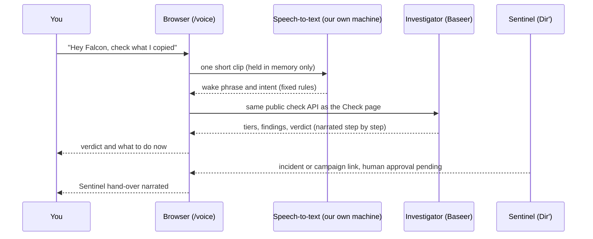

# ARCHITECTURE

```
                 ┌──────────── edge net ─────────────┐
 browser/PWA ──▶ │ gateway (Caddy TLS, CSP)          │ ◀── cloudflared tunnel (host)
 extension   ──▶ │   /        → web (Next.js PWA)    │
 police app  ──▶ │   /v1,/mcp → api, mcp             │
                 └──────────────┬────────────────────┘
                     app net    │
     ┌──────────────┬───────────┴──────┬──────────────┐
     │ api (FastAPI)│ worker (cascade) │ mcp (FastMCP)│ sentinel (LangGraph)
     └──────┬───────┴──────┬───────────┴──────┬───────┘
            │ data net     │ egress via proxy │
   postgres(pgvector)  redis(cache,streams)   egress-proxy ──▶ internet (RDAP, crt.sh, feeds, LLM APIs)
                                   ▲
            sandbox net:  sandbox (Playwright) ──▶ egress-proxy only
   host:  Ollama (OLLAMA_BASE_URL)            obs net: otel-collector → prometheus/loki/tracer → grafana, alertmanager
```

## Request flow (URL)
1. `POST /v1/check/url`: the API validates, rate-limits, assigns a `verdict_id` (ULID), puts a job on the `fl:jobs` stream, and returns `202` with the SSE URL. Single-flight: if a check of the same canonical URL is already in flight, the API attaches to that job.
2. The worker runs T0, T1 and T2, and T3 if needed. After each tier it publishes a partial verdict to `fl:verdict:<id>` (pub/sub), which the API relays to SSE as `event: verdict`.
3. The arbiter produces the final verdict. It is stored in Postgres (`verdicts`, `evidence`) and a `verdict.created` event goes to `fl:events`.
4. The Sentinel (Dir' | درع) consumes `fl:events`, correlates and applies rules. If an incident results, the LangGraph triage runs and the incident is published to `fl:board`, then to SSE on the incident board and to Alertmanager.

### Voice path ("Hey Falcon")
The browser (`/voice`) sends one short clip to `POST /v1/voice/utterance`. The API passes it to a local Whisper engine (native `mlx-whisper` on the Mac, else the `voice` container with `faster-whisper`), decodes it in memory and drops it. Wake phrase and intent come from fixed rules in `falcon_core.voice` first; a scam-safety question is answered by a pre-recorded FAQ clip, and only when no rule matches does a local embedding model (`qwen3-embedding:4b`, `falcon_core/voice/faq_semantic.py`) match the question to the nearest FAQ question, otherwise the assistant redirects to scam checking. No generative model writes an answer. For a check intent the browser then calls the same public check API as the Check page and narrates the Investigator (Baseer | بصير) tiers and verdict, then the Sentinel (Dir' | درع) hand-over, from pre-generated clips (`web/public/voice/<lang>/manifest.json`). The voice service has no direct internet access. Details: `docs/PRIVACY.md`, `docs/RUNBOOK.md`.



Synchronous mode: `?wait=8` blocks up to 8 s and returns the best verdict so far, for simple clients and the MCP.

## Messages, emails and images
- **message**: normalise (Arabic, Arabizi), run rule features, embed with `qwen3-embedding:4b`, run kNN over `scam_scripts` (pgvector), then the quarantined extractor. Every URL found goes through the URL pipeline as a child check (H5).
- **email**: stdlib `email` parser with a size cap and no remote fetch. Checks: auth results, header mismatches, link text vs href, QR codes in images, attachment type and hash only. The body goes through the message pipeline.
- **image**: magic-byte check, QR decode (zxing-cpp or pyzbar), then OCR via the quarantined vision extractor. Extracted URLs and text go through the respective pipelines.

## Model router (`falcon_core/llm/router.py`)
- Roles are `extractor`, `investigator`, `responder`, `vision`, `sentinel`, `judge`. Each role maps to a cloud model and a local model.
- Route selector: `FL_LLM_ROUTE` is `cloud_with_local_fallback`, `local`, `cloud_only` or `auto` (default: cloud with local fallback when a key is set, else local). An operator can change it at runtime on `/ops` (`GET`/`PUT /v1/admin/llm-route`, operator scope, audit-logged), including the local model (Inkling or Qwen 3.8). `GET /v1/meta` reports the effective route read-only, and `/agents` shows it.
- In sovereign mode (`FL_SOVEREIGN_MODE=1`) the route is always `local` and cannot be changed at runtime. When no `ANTHROPIC_API_KEY` is set, every role goes local. On a cloud error or timeout, the call falls back to local and increments `fl_llm_fallback_total`.
- Before any cloud call, inputs are redacted (phone numbers, Emirates ID, card numbers, emails) and spotlighted: untrusted text sits between `<<<UNTRUSTED:{nonce}>>>` markers and each line is datamarked with `^`.
- Output is schema-validated (pydantic) with one repair retry, then falls back to templates.
- Shadow mode: `FL_SHADOW_RATE` sends a fraction of traffic to the other route in the background, to measure `fl_route_agreement_ratio`.

Models in use, their roles, where they run and their status are listed in the README section "Models we use" (sources: `.env.example`, `DECISIONS.md`, the voice manifests). Cloud: `claude-sonnet-5-5` and `claude-haiku-5-5` (only with an API key and sovereign mode off). Local: `inkling-2-mini-chat`, `gemma3:27b` (vision), `qwen3-embedding:4b`. Voice: Whisper large-v3-turbo (`mlx-whisper`) with `faster-whisper` fallback; Kokoro clips (English) and Amazon Polly neural `Zayd` clips (Arabic, generated once offline and kept private). `qwen3.8:27b` is available locally and selectable on `/ops` (sovereign-mode proof runs: `evals/results/published/sovereign/`, read with `docs/EVALS.md`); the Chatterbox clone is planned, not used.

## Data stores
- **Postgres + pgvector**:
  - checking and campaigns: `verdicts`, `evidence`, `scam_scripts` (embedding vector), `brands`, `incidents`, `incident_actions`
  - audit and access: `audit_log` (append-only; UPDATE and DELETE revoked from the app role), `api_keys` (argon2 hash), `reports`, `feedback`, `blocklist`
  - Sentinel state: `langgraph_checkpoints`
- **Redis**:
  - caches: `vc:<sha>` (verdict cache, TTL by verdict: dangerous 24h, suspicious 1h, no_warning 6h) and signal caches (`rdap:`, `crt:`)
  - feed mirror sets: `feed:openphish`
  - rate limits and single-flight locks
  - streams

## Sandbox
- A separate service with a warm pool of Chromium contexts. Every visit gets a fresh context, with downloads blocked, at most 10 redirects and these budgets. **Time:** 6 s wall clock per visit including extraction (the worker waits 7 s; the end-to-end p95 objective is 8 s): up to 4.5 s to reach DOMContentLoaded, the rest to extract features, the favicon and the screenshot hash; one sub-resource may hold the page for at most 2.5 s. If a real document answered but DOMContentLoaded did not arrive in time, the features are read from what loaded (`partial`), not failed. **Size:** the main document is kept up to 8 MB and cut beyond that (`truncated`, still evidence; one declaring more than 32 MB is refused as `size_cap`); all sub-resources together are capped at 5 MB and the excess is refused without failing the page. Both flags reach the cascade as the informational evidence `page.truncated` (weight 0). **Retry and static fallback** (all inside one hard stop of 6.6 s per visit, under the worker's 7 s wait, so the 8 s p95 objective is unchanged): a failed render is retried ONCE in a fresh context only if it failed transiently (timeout, connect reset, navigation failure, renderer crash) and at least 2.4 s of the 6 s are left; never after a policy block (`blocked_by_policy*`, `egress_*`), NXDOMAIN (`dns_failure`), TLS, size or redirect-limit errors. If the browser still failed after the target answered HTTP, the main document is read WITHOUT JavaScript (`page.static_fallback`): the body the browser's route handler already received through the proxy, or (not after a timeout) one fresh GET through the same egress proxy, every redirect hop re-validated by the SSRF policy, read to at most 1 MiB, GET only. It is treated as a partial read, never as clearance. Fonts and media are blocked unless a visual match is needed.
- The page is loaded twice for cloaking detection: once with an Android/Arabic profile, once desktop/English.
- The sandbox returns **features only**: form fields, form-action origins, script-post targets, hot-linked asset origins, title, visible text (≤ 4 KB, for the extractor), favicon and screenshot hashes, `dom_simhash` and the redirect chain. The screenshot is stored in `data/private/snapshots` (local) and served only to authenticated keys.
- Its networks are `sandbox` (peers: `egress-proxy`, plus the fixtures server under the `tools` profile) and `sandbox_ctl` (peer: `worker`). Both are `internal: true`, so there is no route to the internet or to any other service, and the sandbox is NOT on the observability network.
  - Docker networks are not directional, so the sandbox can open connections to `worker` on `sandbox_ctl`. The worker therefore listens there only for `/healthz`, `/readyz` and `/metrics` (including `/metrics/sandbox`), never for a job or control API.
  - The sandbox API requires a shared bearer token (`FL_SANDBOX_TOKEN`) on everything except the health probes, so a stray peer cannot drive visits.
  - Metrics: Prometheus scrapes the worker's `/metrics/sandbox`, which relays the sandbox's metrics over `sandbox_ctl`. Logs: Alloy tails container stdout through the Docker socket. Traces: the worker opens the spans around sandbox calls.
  - Acceptance check: from inside the sandbox container only `egress-proxy:3128` and `worker:8000` accept connections.
- The proxy blocks RFC1918, loopback, link-local, metadata and internal service names, and allows only ports 80 and 443.

## Code ownership
| Path | Owner |
|---|---|
| `packages/falcon_core/{contracts,scoring,cascade,llm,agent,tools}`, `services/worker` | builder-agent-core (sentinel-only tools: builder-sentinel) |
| `packages/falcon_core/scoring/params.yaml` | written **only** by builder-evals' `make fit-thresholds` |
| `packages/falcon_core/telemetry` | builder-observability |
| `services/fixtures` content (Falcon Demo Bank) | builder-sandbox |
| `packages/falcon_core/{signals,brands}` | builder-signals |
| `packages/falcon_core/security`, `services/egress`, `evals/redteam` | builder-security |
| `services/sandbox` | builder-sandbox |
| `services/sentinel` | builder-sentinel |
| `evals/` (except redteam) | builder-evals |
| `services/{api,mcp}`, compose, CI, Makefile | builder-platform |
| `infra/` | builder-observability |
| `web/`, `extension/` | builder-frontend |
| README, `submission/` | builder-docs |

## Sentinel hunt mode (off by default)
Design: `docs/design/HUNTER.md`. Shipped in T-033..T-035; `FL_HUNT_ENABLED=false` by default, and then no hunt task is created and no hunt request leaves.
- **Find.** `sentinel_core/hunt/permute.py` builds look-alike names of each brand's verified domains (typo, homoglyph as punycode, combosquat, TLD swap; typos only for labels of 5+ characters). `falcon_sentinel/hunt/sources/dns.py` checks existence over DNS-over-HTTPS (`NS`, then `A` / `MX`). `sources/ct.py` can look a candidate up on crt.sh (off by default, `FL_HUNT_SOURCES`). `sources/fixture.py` replays a committed TEST FIXTURE file for the demo. Search, ads and Maps are interfaces only (`ready_needs_key`).
- **Egress.** All hunt traffic leaves through `hunt-egress` (allow-list `crt.sh,dns.google`) on the internal `hunt` network. The Sentinel never contacts a candidate domain.
- **Decide.** `scheduler.py` orders candidates by a queue priority (`prescore`, never a risk score) and submits those at or above `FL_HUNT_PRESCORE_MIN`, within `FL_HUNT_SUBMIT_MAX_PER_HOUR` / `_PER_DAY`, to `POST /v1/check/url` with `channel=hunt` and a `hunt`-scope key. The normal cascade and arbiter judge them; the one passive sandbox visit happens there. Pause: Redis `fl:hunt:paused` via `PUT /v1/admin/hunt`.
- **Correlate.** The consumer marks a verdict as hunt-originated only when its `verdict_id` is in `hunt_candidates` (Postgres). Rule R6 `early_warning` opens an incident for a dangerous look-alike; incidents carry `detection {origin, found_before_report, first_hunt_seen, first_user_seen}`. The hunt never publishes `domain.observed`.
- **Show.** `GET /v1/hunt/candidates` (read scope, confirmed only, defanged), `GET`/`PUT /v1/admin/hunt` (operator, audit-logged), `Meta.hunt`; web `/campaigns` section "Hunting | الرصد الاستباقي" and the `/ops` panel; Grafana row "Hunting" on dashboard 6; alerts `HuntStalled`, `HuntSourceBackoff`, `HuntQuotaExhausted`.

