# Falcon Lens: technical reference

This page is for engineers. The plain-language overview is in the [README](../README.md).
Everything here was moved from the README unchanged in meaning; nothing technical was removed.

- [Why](#why)
- [System architecture](#system-architecture)
- [The Investigator](#the-investigator-the-agent-inside-one-check)
- [The Sentinel](#the-sentinel-the-always-on-backend-agent)
- [Features and their status](#features)
- [How scoring works](#how-scoring-works)
- [Security and privacy](#security-and-privacy)
- [Run it](#run-it)
- [Project layout](#project-layout)
- [Evaluation](#evaluation)
- [Status](#status)
- [Roadmap](#roadmap)
- [Documentation](#documentation)

The diagrams on this page are the detailed versions. The simple versions are
[`how-it-works.svg`](assets/how-it-works.svg) and [`ai-agents.svg`](assets/ai-agents.svg).

## Why

People in the UAE receive fake fine, delivery-fee, bank-OTP and UAE Pass links by SMS, WhatsApp and email. The pages look official and are short-lived, so a blocklist often learns about them after people have already opened them. A warning written in English and in security jargon does little for the people who are hit hardest: older and non-technical residents.

Falcon Lens is built on four principles ([`VISION.md`](VISION.md)):

| Principle | What it means here |
|---|---|
| Proactive | A page that claims a brand, asks for credentials and sits on a domain the brand does not own is flagged by rule, even when no blocklist knows it. Single checks are linked into campaigns. |
| Applicable | One command starts the whole stack on a laptop. A sovereign mode keeps every model call on the local machine. |
| Truthful | Every number shown anywhere comes from a generated eval artifact. Replayed and synthetic data are labelled as such. |
| Defensive only | Suspicious pages are loaded once, passively, in an isolated sandbox. No form is ever submitted. |

This section carries no statistics on purpose: a figure appears in this repository only with a public source link or an eval artifact behind it.

## System architecture

<p align="center">
  
</p>

One check, end to end ([`docs/ARCHITECTURE.md`](ARCHITECTURE.md)):

1. **In.** `POST /v1/check/url` reaches the API through the Caddy gateway. The API validates, rate-limits, assigns a `verdict_id`, puts a job on the `fl:jobs` stream and returns the SSE address. Two checks of the same URL share one job.
2. **Cascade.** The worker runs the tiers in order and can exit after any of them. After each tier it re-emits a partial verdict under the same `verdict_id`.

   | Tier | Design budget | What runs |
   |---|---|---|
   | T0 | 50 ms (design budget) | Canonicalise, verdict cache, verified-official registry, local feed mirror |
   | T1 | 1 s (design budget) | Deterministic URL, domain and reputation signals in parallel, plus a calibrated classifier |
   | T2 | 6 s (design budget) | Sandbox render, page and visual features, the brand check, the quarantined extractor |
   | T3 | 15 s (design budget) | The bounded investigator, only for the uncertain band |

   The budgets are design limits from [ADR-001](adr/ADR-001-cascade-arbiter.md), not measurements.
3. **Verdict.** The deterministic arbiter sets the score and the verdict. The result is stored in Postgres and streamed back over SSE.
4. **Events.** A `verdict.created` event goes to `fl:events`. The Sentinel consumes it.

Around that path:

- **Sandbox.** A Playwright service whose only network peer is the egress proxy. It returns features, never raw page content.
- **Model router.** Each role (extractor, investigator, responder, vision, sentinel) maps to a cloud model and a local model. In sovereign mode, or with no API key, every call goes to the local Ollama model.
- **Data.** Postgres with pgvector for verdicts, evidence, incidents and the append-only audit log. Redis for caches, locks, rate limits and streams.
- **Observability.** OpenTelemetry into Prometheus, Loki and an LLM tracer, with Grafana dashboards and Alertmanager. Every log line and span carries the `verdict_id`.

## The Investigator: the agent inside one check

<p align="center">
  
</p>

Models read and explain. Code decides. These guardrails hold that line ([ADR-001](adr/ADR-001-cascade-arbiter.md), [`docs/THREAT_MODEL.md`](THREAT_MODEL.md)):

| Guardrail | How it works |
|---|---|
| Dual-model separation | Untrusted text reaches only the quarantined extractor. That model has no tools, and its output is a strict schema of enums and short strings. The investigator and the responder see structured evidence only. |
| Spotlighting | Untrusted text is redacted, wrapped in random-nonce delimiters and datamarked line by line before any model sees it. Instruction-like text is never followed. It is recorded as risk evidence. |
| Bounded, typed tools | The investigator is an explicit state machine: plan, act, observe, decide. It emits one JSON action per step, validated against [`contracts/tools.schema.json`](../contracts/tools.schema.json), with at most six tool calls per run. A provenance rule rejects any URL or domain argument that is not the input, a hop in its redirect chain, or a domain derived from those. |
| The arbiter is code | Only the arbiter sets `risk_score` and `verdict`. A model can add evidence and write the explanation. It cannot set or lower a score. |
| Grounded reasons | The responder picks at most three reasons, and each must cite existing evidence ids. A verifier rejects anything else and falls back to a native Arabic template. |

The example in the diagram uses the invented brand "Falcon Demo Bank" and defanged, reserved `.example` hosts. No real brand or live URL appears anywhere in this repository.

## The Sentinel: the always-on backend agent

<p align="center">
  
</p>

The Sentinel links single checks into incidents and campaigns ([ADR-002](adr/ADR-002-sentinel-langgraph.md)):

| Stage | What happens |
|---|---|
| Listen | Redis Streams `fl:events`, consumer group `sentinel`, at-least-once delivery. Handlers are idempotent on `event_id`. Repeated failures go to a dead-letter stream. |
| Correlate | Plain, deterministic Python groups events by page fingerprint, brand, domain pattern, ASN, registrar, certificate issuer, script cluster and time window. |
| Trigger | Unit-tested rules open incidents: R1 campaign, R2 kit reuse, R3 report burst, R4 reputation flip, R5 quality. |
| Triage | A LangGraph `StateGraph` (`enrich → compare → assess → summarise → propose → act`) with a Postgres checkpointer, per-node retries and a fixed step, token and time budget per incident. |
| Act | Internal actions (block an indicator with a TTL, raise an alert, update the campaign board, export STIX) run automatically and are reversible. External actions (a takedown draft, a police report draft) stop at an `interrupt()` and wait for an operator. The Sentinel never sends them. |

Rules and correlation decide what an incident is, so incident counts are reproducible with the model stubbed. The agent only enriches an incident: severity reason, summary and proposed actions. It cannot edit rules, thresholds or scoring. Every action is written to the append-only `audit_log` with the evidence ids behind it.

## Why DSPy and LangGraph

The website shows the whole system as one connected, clickable diagram on `/docs/agents` (full) and `/agents` (simplified). Each node and each tool opens a panel with what it does, why it exists, what it never does, inputs and outputs, its path in this repository and its Live or In progress status (from the capability flags). The diagram and this section are generated from the same data (`web/lib/arch-graph.ts`, `web/lib/i18n-arch.ts`).

**DSPy: typed roles and measured prompts.** A DSPy `Signature` defines the typed inputs and outputs of one model role; that is the contract we validate (schema, cited evidence ids that exist, tool arguments that pass the registry). DSPy treats the strategy as an interchangeable module (`Predict`, `ChainOfThought`, `ReAct` and others). We use `dspy.Predict` with Signatures and none of the others: our roles return short, deterministic JSON and a verifier checks every reply, so a reasoning or tool-loop module would add tokens and variance without a check to catch it. The optimisers `BootstrapFewShot` and `MIPROv2` (light) tune instructions and few-shot demos offline, with the production validators as the metric. Each role and route gets its own compiled prompt, stored as frozen JSON with a checksum and loaded without importing `dspy`; a missing or altered file falls back to the hand-written prompt. A compiled prompt is adopted only if it beats the hand-written one on held-out validation cases, and we report a gain only when the paired 95% interval of the difference excludes zero. Status: this is **In progress** until the loader (`falcon_core.prompts.compiled`) and at least one adopted compiled file are on the tree (the `dspy_compiled_prompts` capability flag); any before and after table is rendered only from `evals/results/published/dspy/`.

**Tracing.** The `fl_` metrics go to Prometheus and Grafana. LLM calls are meant to be traced with Arize Phoenix through OpenTelemetry (the `phoenix` service and the collector route are in docker compose), but the services only start the tracer once `setup_tracing()` is called in their start-up code; until then this is **In progress** (the `llm_tracing` capability flag, true only when that call and the collector route exist). MLflow is not used.

**LangGraph: an auditable map for the Sentinel.** An explicit `StateGraph` is a visible map of the Sentinel's steps and of the tools each step may call. The Postgres checkpointer makes it restart-resilient and resumable; `interrupt()` stops it for human approval before any external action; per-node budgets and retries, with per-node metrics and traces, give a full view of performance. Deterministic rules decide what an incident is; the model only enriches it.

**The Investigator is not LangGraph.** It is a bounded plan, act, observe, decide state machine (ReAct-style tool use, but not DSPy's `ReAct` module) with at most 6 typed tool calls. That keeps a check short and bounded, resists injection (one typed action per step, never free text that something acts on) and keeps results reproducible, because the arbiter, not the model, sets the score ([ADR-001](adr/ADR-001-cascade-arbiter.md)).

## Features

Status as of Mon 23 Nov 2026. Legend: **merged** is on `main` with its tests. **scaffold** means the service, schema or config is on `main` but has no product behaviour yet. **in progress** is being built on a feature branch or sits in an open pull request, and is not merged. **planned** has not started. Gates are recorded in `STATUS.md`; merged does not by itself mean a gate has passed.

### Product

| Feature | Description | Status |
|---|---|---|
| URL check | Paste a link and get a progressive verdict over SSE | in progress: the address-level path (signals #1 and #26, arbiter #13, cascade and worker #18, check API #4) and sandbox capture (#28) are merged; joining the sandbox, domain and reputation signals and the investigator into the cascade is PR #44 (open) |
| SMS and WhatsApp text check | Arabic, Arabizi and English message analysis, rule features and nearest known scam script. Every link found is checked as a URL. | in progress: signals merged (#8); the message pipeline is not wired into the cascade yet |
| Email check | `.eml` parsing with no remote fetch: authentication results, header mismatches, link text against target, QR codes, attachment type and hash only | in progress: signals merged (#8), fixtures merged (#24); pipeline not wired yet |
| Image and QR check | QR decode and quarantined OCR. Extracted links and text go through the URL and message pipelines. | in progress: signals merged (#8); pipeline not wired yet |
| Arabic-first verdicts | Three verdicts: `dangerous`, `suspicious`, `no_warning_signs`. The product never says "safe". Reasons cite evidence ids. | merged (#13, #19); native-speaker review of the Arabic strings in PR #23 |
| Actions and reporting | What to do now, what to do if you already clicked, and reporting channels taken only from the official site ([`config/`](../config)) | merged (report intake in #30) |
| PWA and share target | Next.js web app, Arabic-first RTL. Android share sheet through the PWA share target. | merged (#35) |
| Chrome extension | Manifest V3. Sends only the URL. Host permission only for the API origin. | merged (#34) |
| Campaign board | Similarity view of linked checks and live campaigns | merged (API #30, web app #35) |
| Operator incident board | Incidents, evidence, and approve or reject for drafted external actions | merged (API #30, web app #35) |
| REST v1 | `POST /v1/check/*`, SSE stream, `?wait=` synchronous mode, scoped API keys | merged (check endpoints, SSE and `?wait` #4; keys, intake and incidents #30) |
| MCP server | Streamable HTTP with bearer auth: `check_url`, `check_message`, `check_email`, `get_verdict`, `list_campaigns`, `list_incidents`, `get_incident`, `submit_report` | merged (#30) |
| STIX 2.1 export and webhooks | Incident export and HMAC-signed webhooks for police or SOC systems, ready to connect | merged (#30) |
| Sovereign mode | `FL_SOVEREIGN_MODE=true` sends every model call to the local Ollama model | merged with the model router (#19); the sovereign route has no published eval yet |
| Observability dashboards | Six Grafana dashboards, `fl_` metrics, alerts with a runbook entry each | merged (#14) |
| Demo tooling | `make seed`, `make replay`, `make demo`, tunnel | merged (#21, #32) |
| Red-team suite | Prompt-injection, SSRF and XSS fixtures run by `make redteam` | in progress (PR #41, open) |
| Submission kit | `make submission` builds the form fields, deck and description | merged (#31); `make submission` marks the package NOT READY until the end-to-end check ships |

### AI agents and detection core

| Feature | Description | Status |
|---|---|---|
| URL lookalike signals | Homograph, typosquat, combosquat and related lexical signals over a brand registry with verified domains | merged (#1, #9, #22) |
| Domain, certificate and feed signals | Domain age, certificate age, reputation feed mirror | merged (#26) |
| Message, email and image signals | Deterministic rule features | merged (#8) |
| SSRF guard and egress proxy | Own DNS resolution, blocked ranges, pinned IP, redirects re-checked; the egress proxy uses the same guard | merged (#3, #16) |
| Tiered cascade and worker | T0 to T2 orchestration, early exits, partial verdicts | merged (#18) |
| Deterministic arbiter | Hard rules H1 to H6, calibrated score, bands, degradation | merged (#13; scoring docs update in PR #15) |
| Sandbox capture and fixtures | Isolated Playwright capture, page features, Falcon Demo Bank fixtures | merged (#28) |
| Quarantined extractor | No tools, strict schema, spotlighted input | merged (#19) |
| Bounded investigator (T3) | State machine with typed tools, the provenance rule and budgets | merged (#19) |
| Responder and verifier | Reasons that cite evidence ids, with a template fallback | merged (#19) |
| Model router | Cloud and local routes, redaction, fallback to local on a cloud error | merged (#19) |
| Sentinel core | Correlation and rules R1 to R5 | merged (#2) |
| Sentinel triage graph | LangGraph nodes, Redis consumer, Postgres checkpointer, human-approval interrupt | merged (#6) |
| Eval harness | Datasets, first-stage model fit, harness, merge gate, published artifacts | merged (#29, #7, #24); more hard negatives in PR #25 |
| Offline prompt optimisation | DSPy on the validation split; compiled prompts are frozen | in progress (PR #45, open) |

## How scoring works

The arbiter is the only component that sets `risk_score`, `calibrated_probability` and `verdict`. Full detail is in [`docs/SCORING.md`](SCORING.md).

1. **Hard rules first.** A rule that fires sets the floor of the verdict, or the cap for the trust rule.
2. **Classifier probability.** A gradient-boosted model over the T1 features, calibrated on the validation split.
3. **Evidence adjustment.** Evidence from the later tiers has fixed weights in log-odds points: `logit(p) = logit(p_clf) + Σ wᵢ · confidenceᵢ`.
4. **Bands.** `dangerous`, `suspicious` or `no_warning_signs`. The thresholds are fitted on the validation split only and frozen, and evals gate any change.

| Hard rule | Condition | Effect |
|---|---|---|
| **H1** brand mismatch (zero-day) | The page claims a brand, has a credential form or payment request, and its registrable domain is not in that brand's verified list | `dangerous` |
| **H2** known bad | Fresh feed hit on the exact URL or host | `dangerous` |
| **H3** verified official | The registrable domain is in a brand's verified list, with no open-redirect abuse and no feed hit | Capped at `no_warning_signs`, never `dangerous` |
| **H4** exfiltration to a bot | A form or script posts credentials to a messaging-bot API or webhook relay | `dangerous` |
| **H5** message with a dangerous link | A message or email contains a URL whose verdict is `dangerous` | At least `dangerous` |
| **H6** OTP or remote-access ask | A message asks for an OTP or a remote-access app install and impersonates an authority or bank | At least `suspicious` |

Two rules protect the lowest verdict. A degraded check (a signal failed or timed out) is never shown as `no_warning_signs`. And the lowest verdict reads "No warning signs found" / «لم نجد علامات تحذير» with a caution reminder, never "safe".

## Security and privacy

The checker fetches content that attackers control, so it is designed as a target. The full STRIDE table is in [`docs/THREAT_MODEL.md`](THREAT_MODEL.md), and data handling is in [`docs/PRIVACY.md`](PRIVACY.md).

| Risk | Mitigation |
|---|---|
| A page talks the model into lowering its score | The arbiter is code. Model output cannot reach the score. Injection attempts are recorded as risk evidence. |
| SSRF into the host or internal network | Own DNS resolution, blocked private, loopback, link-local and metadata ranges, pinned IP, every redirect re-checked, and the egress proxy as a second layer |
| A browser exploit in the sandbox | Non-root, read-only root filesystem, all capabilities dropped, isolated network, fresh context per visit |
| The checker used as a free fetcher | Raw content is never returned. Screenshots only for authenticated keys. Per-IP and per-key limits. |
| Stored XSS on the boards | Text nodes only, strict CSP, URLs shown defanged and never as live links |
| Personal data leaving the machine | Phone numbers, Emirates ID, card numbers, emails and IBANs are redacted before logging and before any cloud call. Message bodies are not stored unless the user opts in to a report. |

In sovereign mode no content leaves the machine. Lookups (RDAP, certificate transparency, feeds) carry domain names only and can be switched off. The product never asks for personal, banking or ID details.

Residual risks are stated in the threat model, including that Docker Desktop on macOS provides VM isolation without gVisor, and that phishing pages may cloak against data-centre addresses.

## Run it

Requirements: Docker with Compose, and [`uv`](https://docs.astral.sh/uv/) for the test suite. Ollama on the host is optional and enables the local model route.

```bash
cp .env.example .env    # every key is optional; a missing key switches that feature off
make up                 # build and start the core and observability stacks, wait until healthy
make smoke              # one URL in, one verdict out
make demo               # the demo scenarios
```

Honest state of those targets on `main`: `make up`, `make down`, `make test`, `make scan`, `make smoke`, `make eval`, `make seed`, `make replay`, `make demo`, `make urls`, `make tunnel`, `make demo-reset` and `make submission` are implemented. Implemented does not mean the gate has passed: `make smoke` runs against the real worker, gate G1 counts only once [`STATUS.md`](../STATUS.md) records it as passed, and the fake-worker mode is a test double that never counts as G1. `make eval` is the offline evaluation described under [Evaluation](#evaluation); the artifact states its own scope. `make submission` builds the submission package and marks it NOT READY until the end-to-end check ships ([`submission/README.md`](../submission/README.md)). `make redteam` exits with "not yet implemented". A target that is not built never passes silently. Per-script documentation is in [`docs/SCRIPTS.md`](SCRIPTS.md) (added by PR #40, not yet merged).

When the stack is up:

| Service | Address |
|---|---|
| App | `https://localhost:8443` (local CA, accept the certificate warning) |
| Grafana | `http://localhost:3001` |
| Prometheus | `http://localhost:9090` |

To keep every model call local, set `FL_SOVEREIGN_MODE=true` in `.env`. The local model tags are set in `.env` and explained in [ADR-003](adr/ADR-003-local-model.md).

## Project layout

```
services/api        FastAPI REST v1, SSE, auth, rate limits
services/worker     cascade orchestration (T0 to T3), signals, arbiter
services/sandbox    Playwright browser service (isolated network)
services/egress     filtering egress proxy
services/sentinel   event consumer, correlation, rules, LangGraph agent
services/mcp        MCP server (streamable HTTP)
extension/          Chrome MV3 extension
packages/falcon_core  shared library: contracts, signals, scoring, model router, tools
web/                Next.js PWA (Arabic-first RTL), incident board
contracts/          JSON Schemas: verdict, evidence, event, incident, signal, tools
evals/              harness, dataset manifests, published results
infra/              gateway, grafana, prometheus, loki, alloy, alertmanager, otel, postgres
docs/               vision, architecture, ADRs, scoring, threat model, privacy, runbook
scripts/            repo tooling (health wait, README metrics)
```

Live phishing URLs, page snapshots and brand logos are never committed. They stay in the git-ignored `data/private/`. Only defanged URLs, hashes, embeddings and aggregates are public.

## Evaluation

The method is in [`docs/EVALS.md`](EVALS.md): splits grouped by registrable domain, a frozen test split, bootstrap confidence intervals, and cloud and sovereign routes reported separately. Targets are listed there.

Results are shown in one place only: the [Results section of the README](../README.md#results). That block is written by [`scripts/readme_metrics.py`](../scripts/readme_metrics.py), which copies values verbatim from the newest file in `evals/results/published/`. Each artifact states its own scope and what it did not evaluate; read those lines before the figures.

## Status

Gates are tracked in [`STATUS.md`](../STATUS.md). At the time of writing that file records no gate as passed, so this document does not claim one. A feature marked "merged" below is on `main` with its tests; that is a weaker statement than "works end to end for a user".

Gates G0 to G6, from [`STATUS.md`](../STATUS.md):

| Gate | Target | State (from `STATUS.md`) |
|---|---|---|
| G0 `make up` healthy | Sun 19:00 | in progress |
| G1 `make smoke` URL to verdict | Mon 06:00 | not recorded as passed |
| G2 `make eval` baseline | Mon 14:00 | not recorded as passed |
| G3 red-team 0%, scans clean, 5 dashboards | Mon 22:00 | not recorded as passed |
| G4 MVP (organiser rule) | Tue 08:00 | not recorded as passed |
| G5 Sentinel incident from replay | Tue 15:00 | not recorded as passed |
| G6 `make demo` + `make submission` | Tue 20:00 | not recorded as passed |

Every pull request in the repository, from `gh pr list --state all` on Mon 23 Nov 2026 (titles as written by their authors):

| PR | State | Title |
|---|---|---|
| #1 | merged | feat(signals): T-007 URL/lexical signals, brand registry, UTS#39 skel… |
| #2 | merged | Feat/sentinel core |
| #3 | merged | T-003: SSRF guard and guarded async HTTP client (library) |
| #4 | merged | feat(api): T-013 check endpoints + SSE + ?wait, T-015 make smoke |
| #5 | merged | T-001: platform skeleton (uv workspace, services, compose, Makefile, CI) |
| #6 | merged | feat(sentinel): LangGraph triage agent, Redis consumer, Postgres persistence, tools |
| #7 | merged | feat(evals): legit URL set (411 verified rows) and scripts/qwen_task.… |
| #8 | merged | feat(signals): message, email and image deterministic signals |
| #9 | merged | fix(signals): PR-5 review changes (fixtures, escapes, url.data_uri, ruff) |
| #10 | merged | T-001 review fixes (G0): sandbox isolation, deps, ports, PR CI |
| #11 | open PR | ci: hotfix main — lint config, formatting, missing deps, trivy pin |
| #12 | merged | git: union merge for DECISIONS/STATUS/TASKS (keep both sides) |
| #13 | merged | feat(scoring): arbiter + hard rules H1-H6 + template reasons (T-011, review round 2) |
| #14 | merged | T-014: fl_ metrics registry, dashboards, alert rules, Alertmanager route |
| #15 | open PR | docs(scoring): investigator evidence names |
| #16 | merged | T-003: SSRF review fixes (PR-4), POST allow-list, egress proxy on the shared guard |
| #17 | merged | docs: README with animated architecture, Investigator and Sentinel diagrams |
| #18 | merged | T-012: cascade T0-T2 + worker (fl:jobs consumer, progressive verdicts) |
| #19 | merged | feat(core): LLM router, tool registry + provenance, extractor, investigator, responder (T-024, T-025) |
| #20 | open PR | fix(env): inline comments were parsed as values |
| #21 | merged | Demo tooling: seed, replay, demo, tunnel, demo-reset (G6) |
| #22 | merged | data(brands): verify the 6 weakly verified official domains (C02) |
| #23 | open PR | i18n(ar): native-speaker review of brand names and verdict strings (C01) |
| #24 | merged | evals: 40 fictional .eml fixtures for the email pipeline (C05) |
| #25 | open PR | feat(evals): C06 more legitimate hard negatives (new domains, official short links) |
| #26 | merged | T-008: domain (RDAP, crt.sh) + reputation (OpenPhish mirror, GSB/URLhaus) signals |
| #27 | merged | docs: README status tables from live PR state (follow-up to #17) |
| #28 | merged | T-004/T-009: sandbox capture, page features, Falcon Demo Bank fixtures |
| #29 | merged | T-020/T-022/T-023: datasets, T1 fit, eval harness + gate |
| #30 | merged | feat(integration): API keys, intake, incidents, STIX, webhooks, MCP server |
| #31 | merged | docs: demo script and submission kit (make submission, number tracing) |
| #32 | merged | fix(demo): live-URL guard failure + fail-closed fixture gate (#21 follow-up) |
| #33 | merged | docs: STIX intel-scope refang decision |
| #34 | merged | feat(extension): Chrome MV3 extension (navigation guard, hover check, popup, options) |
| #35 | merged | feat(web): real Falcon Lens web app (Fable 5.2) |
| #36 | open PR | docs: single page-evidence builder decision |
| #38 | merged | reviews: supervisor review records batch 1 |
| #39 | open PR | fix(env): inline comments parsed as values + guard (supersedes #20) |
| #40 | open PR | docs: usage headers on every script, make help for every target, docs/SCRIPTS.md |
| #41 | open PR | T-026: injection detector + red-team suite (92 cases, attack success 0/92) + scan/XSS checks |
| #42 | open PR | docs: plain-language README, simple diagrams, technical detail in docs/TECHNICAL.md |
| #43 | open PR | chore(agents): Sonnet builders, Opus supervisor only (owner) |
| #44 | open PR | feat(cascade): wire OpenPhish mirror, domain/reputation signals, worker env (G1) |
| #45 | open PR | feat(evals): offline DSPy optimisation pipeline + frozen compiled prompts (ADR-002) |

Reputation feeds: Google Safe Browsing is disabled (no key) and URLhaus is disabled (no key), per `STATUS.md`. The OpenPhish community feed is limited to non-commercial research use, per the terms note in [`DECISIONS.md`](../DECISIONS.md).

## Roadmap

- **OpenPhish licence for production.** The community feed allows personal and research use, with no commercial use and no redistribution. This prototype mirrors it privately and publishes only defanged aggregates. A production deployment needs an OpenPhish licence.
- **More feeds.** Enable Google Safe Browsing and URLhaus when keys are available. Until then the blocklist baseline covers only the enabled feed.
- **Sandbox hardening.** gVisor or an equivalent runtime on a Linux host, and residential or mobile egress to reduce cloaking.
- **Stricter CSP.** Move the gateway from inline hydration scripts to nonces.
- **iPhone share flow.** iOS has no PWA share target, so an iOS Shortcut is planned.
- **Alert channels.** Telegram and webhook delivery for Alertmanager once a channel is configured.
- **Police system integration.** REST v1, MCP, STIX 2.1 and signed webhooks are designed to be ready to connect. Any real connection needs an agreement with the receiving organisation. See [`docs/INTEGRATION.md`](INTEGRATION.md).

## Documentation

| Doc | What |
|---|---|
| [`docs/VISION.md`](VISION.md) | Problem, users, principles |
| [`docs/ARCHITECTURE.md`](ARCHITECTURE.md) | Services, data flow, cascade, networks |
| [`docs/adr/`](adr) | Decisions: cascade and arbiter, Sentinel on LangGraph, local model, tunnel, event bus |
| [`docs/SCORING.md`](SCORING.md) | Arbiter features, weights, hard rules, bands |
| [`docs/THREAT_MODEL.md`](THREAT_MODEL.md) | STRIDE, SSRF, sandbox, injection, XSS |
| [`docs/PRIVACY.md`](PRIVACY.md) | Data minimisation, redaction, cloud and sovereign flows |
| [`docs/EVALS.md`](EVALS.md) | Datasets, splits, metrics, merge gate |
| [`docs/OBSERVABILITY.md`](OBSERVABILITY.md) | Metrics, dashboards, alerts |
| [`docs/INTEGRATION.md`](INTEGRATION.md) | REST v1 and MCP for police systems, ready to connect |
| [`docs/RUNBOOK.md`](RUNBOOK.md) | One entry per alert |
| [`docs/CONTRACTS.md`](CONTRACTS.md) and [`contracts/`](../contracts) | The schemas every surface shares |
| [`DECISIONS.md`](../DECISIONS.md) | Assumptions and verified versions, one line each |

The diagrams are self-contained animated SVGs in [`docs/assets/`](assets): no scripts, no external resources, system fonts only. They stop animating when the reader's system asks for reduced motion.
