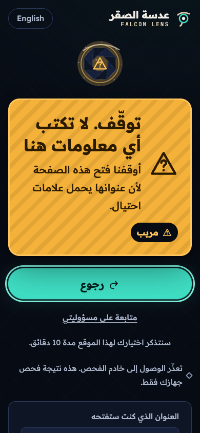
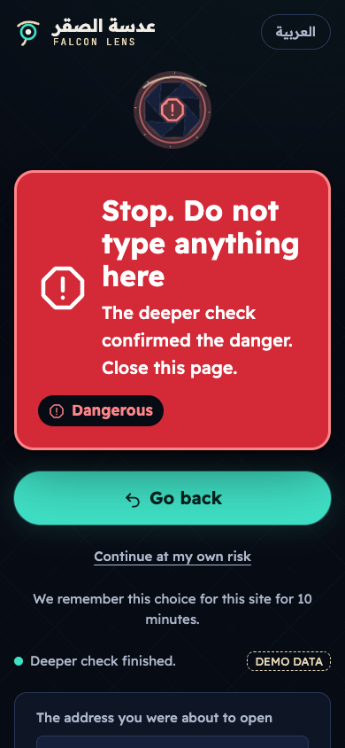
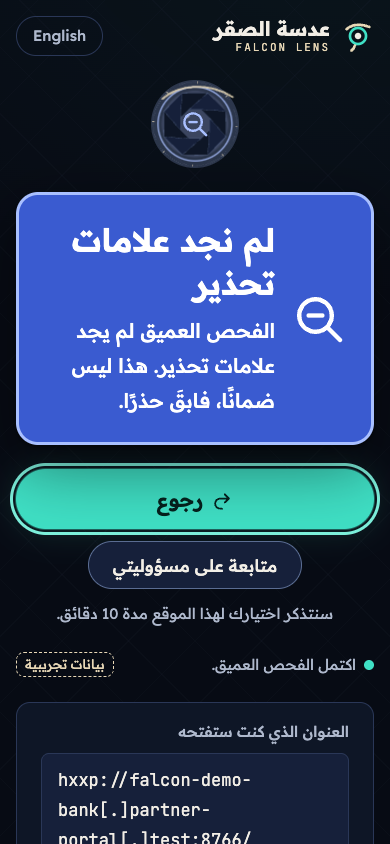
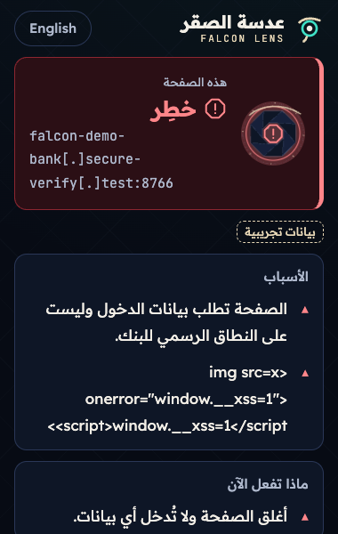
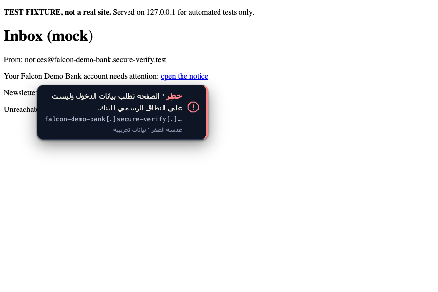
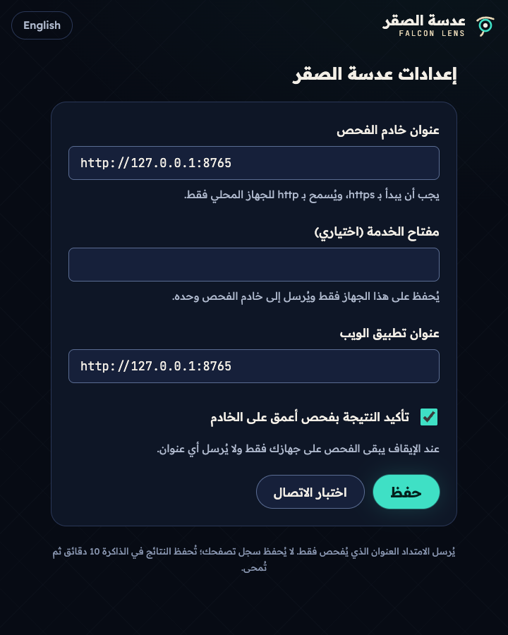

# Falcon Lens | عدسة الصقر — Chrome extension (Manifest V3)

Warns before you type on a suspicious page, and checks links in webmail and chat web apps.
Arabic first, with an English switch. Design: `docs/DESIGN.md` (Night theme tokens).
Privacy and every permission: [`PRIVACY.md`](PRIVACY.md).

## What it does

1. **Navigation guard.** On every top-frame navigation the service worker runs an on-device lexical
   check (`src/prefilter.ts`): brand name in a host that is not the brand's domain, one-character
   and digit-swap lookalikes, IDN homographs and mixed alphabets, public IP hosts, `user@host`
   tricks, and free hosts or tunnels with a service word. If the address is risky, the tab is sent
   to a full-page warning with **Go back** as the main action and a small "Continue at my own risk".
   The warning then asks the server (`POST {API}/v1/check/url?wait=6`) and upgrades to *Dangerous*
   or downgrades to *No warning signs found* in place. It never says "safe".
2. **Hover check.** On `mail.google.com`, `outlook.live.com`, `outlook.office.com`,
   `web.whatsapp.com` and `web.telegram.org`, resting on a link for 400 ms shows a small badge with
   the on-device result and then the server verdict. Results are cached per URL for 10 minutes.
3. **Popup.** The current tab's verdict with up to three reasons and a link to the web app.
4. **Options.** API base URL, optional API key, web app URL, server checks on or off.

| Warning (Arabic) | After server confirmation (English) | Downgraded |
|---|---|---|
|  |  |  |

| Popup | Hover badge in a mock webmail page | Options |
|---|---|---|
|  |  |  |

The screenshots come from the automated tests (`pnpm shots`). They use the invented brand
"Falcon Demo Bank", reserved `.test` hosts and a mock API on 127.0.0.1, so every verdict in them
carries the `DEMO DATA` badge. One popup reason is a deliberate XSS test string shown as plain text.

## Build

```bash
pnpm --dir extension install
pnpm --dir extension build          # -> extension/dist
pnpm --dir extension zip            # -> extension/build/falcon-lens-extension-<version>.zip
```

The API origin is fixed at build time and is the only host permission in the manifest:

```bash
FL_API_BASE=https://your-tunnel.example FL_WEB_BASE=https://your-tunnel.example pnpm --dir extension build
```

Default: `https://localhost:8443` (the local gateway). `https` is required; `http` is accepted for
`localhost` and `127.0.0.1` only. The brand list is generated from `data/brands.yaml` on every build.

## Load unpacked

1. Run the build above.
2. Open `chrome://extensions` in Chrome or Chromium 116 or newer.
3. Turn on **Developer mode** (top corner).
4. Click **Load unpacked** and choose the `extension/dist` folder.
5. Pin "Falcon Lens | عدسة الصقر" from the puzzle-piece menu.
6. Open the extension's **Options** to change the server address or add an API key. Saving a new
   address makes Chrome ask for permission to that one origin.

With the local stack (`make up`), the gateway uses a local CA. Open `https://localhost:8443` once
and accept the certificate, or the server check will report that the server cannot be reached and
the extension will fall back to the on-device result.

To try it without a real scam page: after loading, visit
`http://falcon-demo-bank.secure-verify.test/`. The `.test` name does not resolve, and the warning
page appears anyway because the check runs before the request.

## Test

```bash
pnpm --dir extension lint       # tsc + static rules (no innerHTML, no inline script, no "safe")
pnpm --dir extension test       # vitest: prefilter, response validation, settings
pnpm --dir extension exec playwright install chromium
pnpm --dir extension test:e2e   # Playwright: unpacked extension in Chromium against a mock API
```

The e2e build (`dist-e2e`) differs from the release build in two ways only: the API origin is the
mock on `127.0.0.1:8765`, and the hover script also matches `http://webmail.test/*`, a reserved
name that stands in for a webmail app.

## Layout

```
src/prefilter.ts    on-device check (pure, unit tested)
src/background.ts   service worker: navigation guard, server check, 10-minute cache
src/content.ts      hover badge (closed shadow root, text nodes only)
src/warning.ts      full-page warning      src/popup.ts   popup      src/options.ts  options
src/ui.ts           DOM helpers, lens, icons      src/i18n.ts  Arabic and English strings
static/             HTML shells, ui.css, tokens.css (copy of web/design/tokens.css), icons
scripts/            build, data generation, icon rendering, static checks
```

## Known limits

- The on-device check has no Public Suffix List and a small look-alike table. It is a tripwire,
  not a verdict; the server decides.
- A name from the brand list inside another organisation's honest address is flagged until the
  server answers.
- Chrome may send the first request of a replaced navigation before the warning takes over. The
  page is never shown.
- Chrome and Edge stable no longer accept `--load-extension`; the e2e tests use Playwright's
  Chromium. Manual loading through `chrome://extensions` works in all of them.
